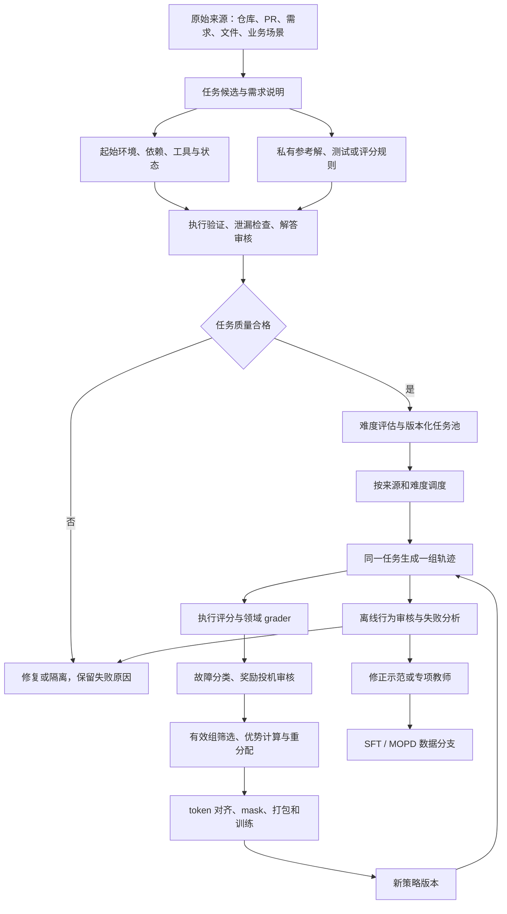

# MiMo 后训练数据构建 pipeline：来源、清洗、验证、训练闭环与改进

资料核对截止：2026-10-12。研究对象是 MiMo-V2.6 系列公开披露的后训练流程，并结合 CodeMidas、GAGAR、MiMo 官方故障复盘及固定版本的开源代码进行分析。

本文关心的不只是“训练文本从哪里来”，而是一个任务如何成为可执行环境，如何生成可信的奖励，再如何成为真正参与梯度更新的数据。文中的工程示例、伪代码、目录结构和改进方案均为整理者的分析与建议，不代表小米未公开的内部实现。

阅读导航：[总体流程](#pipeline-overview) · [CodeMidas 构造细节](#codemidas-details) · [公开代码接口](#public-code) · [完整教学示例](#worked-example) · [来源索引](#sources)

## 1. 阅读范围与证据边界

### 1.1 哪些内容能够确认

本文用四种标签区分证据：

| 标签 | 含义 | 使用方式 |
| --- | --- | --- |
| **论文事实** | MiMo 主报告、CodeMidas 或 GAGAR 明确披露 | 给出论文与章节；实验数字保留实验对象 |
| **代码事实** | 指定提交中的公开代码可以直接确认 | 给出固定 commit 的文件链接；不外推为全部生产配置 |
| **分析／建议** | 根据公开机制推导出的影响、示例或改进 | 说明假设，不写成 MiMo 已实施的措施 |
| **未披露** | 当前公开材料不能确定 | 不补造数据配比、模型名称、阈值或过滤提示词 |

主要论文是：

| 来源 | 本文使用范围 | 不能由它推出的结论 |
| --- | --- | --- |
| [MiMo-V2.6 主报告][P1]，arXiv v1 提交于 2026-10-08 | 整体后训练、各领域任务构建、奖励、训练系统 | 完整原始数据清单和全部生产配置已开放 |
| [CodeMidas][P2]，2026-09-18 | 从已有代码功能构建 RL 环境及质量筛选 | 5,545 个任务就是 V2.6 的完整代码训练集 |
| [GAGAR][P3]，2026-09-26 | 通过组内 agentic grading 改善代码轨迹的训练信号 | 公开小模型训练脚本默认启用了论文全部功能 |
| [MiMo 工具重复调用复盘][P4]，2026-09-27 | 已发生的奖励盲区、行为退化及修复 | 最新修复权重仍与最初 RL 权重具有相同故障率 |

CodeMidas 的主要训练实验基于 **MiMo-V2.5**；MiMo-V2.6 主报告将这类方法纳入更大的任务构建体系。两者有关联，但数据规模、实验模型和训练设置不能混用。[P1]、[P2]

### 1.2 公开了什么，尚缺什么

公开材料足以追踪“任务 → 环境 → 轨迹 → 评分 → 优势 → 训练”的主要接口。公开的 [MiMo-V2.6-RL-oss][D1] 是 7K+ 任务级数据的开放子集，不能据此还原旗舰训练的全部来源、混合比例和版本历史。

目前不能完整确认的内容包括：

- 所有原始仓库、商业授权数据、内部需求的逐条清单。
- 生产版各阶段的精确数据配比、去重阈值与基准污染排除规则。
- 所有任务构造、测试生成和审核所用模型的名称、版本与完整提示词。
- 全部 SFT 数据的筛选、去重、人工复核比例和 loss mask。
- CodeMidas 最后难度筛选所用的完整模型集合与采样次数。
- 各领域生产环境的完整镜像、grader 配置、运行成本和过滤失败日志。

因此，本文同时提供两层内容：已证实的机制，以及要把这些机制做成可审计数据工厂时应补齐的工程规范。后者不冒充原始实现。

<a id="pipeline-overview"></a>

## 2. 总体 pipeline：先构建任务，再在线生成训练数据

### 2.1 后训练所处的位置

MiMo 主报告描述的总体顺序是：面向 agent 的 mid-training、短阶段 SFT、混合任务 RL，以及多教师 on-policy distillation。Mid-training 涉及 agent 轨迹、文本与代码、多模态内容；RL 阶段主要围绕代码、通用任务、视觉设计和网络安全等环境运行。[P1：整体训练与 §4][P1]

这几个阶段的数据对象不同：

| 阶段 | 主要数据对象 | 监督来源 | 需要特别清洗什么 |
| --- | --- | --- | --- |
| Mid-training | 文本、代码、交互轨迹、多模态序列 | token 预测及对应训练目标 | 内容质量、格式、跨来源重复、错误行为 |
| SFT | 指令与示范轨迹 | 示范中的模型输出 | 示范正确性、工具协议、上下文与答案对应关系 |
| RL 任务工厂 | 任务说明、起始环境、隐藏 verifier | 尚未直接形成策略梯度 | 任务可解性、环境可执行性、答案泄漏、测试可靠性 |
| 在线 RL | 当前策略在环境中的多条轨迹 | 执行结果、rubric、组内 grader | 环境故障、奖励投机、无效组、过旧策略轨迹 |
| MOPD | 学生轨迹或前缀续写，以及教师概率反馈 | 教师对学生生成 token 的条件评分 | 教师选择、前缀分布、轨迹来源与行为质量 |

不能用“抓网页 → 去重 → 拼成 JSONL”概括这一过程。RL 样本本质上包含一个可以重复初始化、执行和判断结果的实验。

### 2.2 整体数据流

下图是对公开机制的综合表达，不是官方组件图。任务来源和评分分支因领域而异。



### 2.3 至少区分五种数据记录

以下是**建议的数据建模**，用于避免任务、环境和轨迹互相混淆：

1. **Source**：仓库、文件、业务需求等原始来源，带来源版本与使用许可。
2. **Task**：用户目标、允许的修改范围、成功标准。
3. **Environment**：起始文件、数据库、工具、依赖和镜像版本。
4. **Verifier**：隐藏测试、状态检查、评分 rubric、grader 版本。
5. **Rollout**：某个策略版本在某个环境实例中的实际动作、观察、结果与训练元数据。

一个 Task 可以对应多个 Environment 版本和很多 Rollout。Verifier 一旦改变，旧 reward 不应继续当成新版本的评分使用；是否可以重评，取决于是否保留了足够的执行状态和轨迹证据。

## 3. 数据来源：不同来源如何转成可训练任务

### 3.1 代码任务有多条构建路径

MiMo 主报告 §4.2.1 披露了多种代码任务来源与构建方式。[P1][P1]

| 路径 | 原始输入 | 转换成的训练对象 | 核心清洗点 |
| --- | --- | --- | --- |
| GitHub issue / PR | 问题描述、仓库上下文、参考补丁 | 起始代码 + 修复需求 + 测试 | 重复、格式错误、无法复现、需求中泄漏实现 |
| 内部开发需求 | 功能、重构、排错、维护请求 | 工程任务 + agent 构造的验证 | 将含糊需求改为可判断的验收条件 |
| 详细规格生成 | 多约束任务规格 | 要求明确、约束较密的构造任务 | 规格自相矛盾、约束没有对应测试 |
| CodeMidas | 已实现的开源代码功能 | 删除部分实现后的起始状态 + 行为契约 | 原实现泄漏、测试过拟合参考实现 |
| 长程任务扩展 | 较小任务或已有规格 | 跨模块、多依赖、更多步骤的任务 | 扩展后依赖是否齐全、要求是否仍能验证 |
| 公共／授权任务池 | SWE 类任务、终端任务及其他数据供应 | 经统一适配的环境任务 | 协议统一、环境质量、来源重叠和授权范围 |

报告还提及 SWE-Lego、SWE-rebench V2、MultiSWE、SWE-Universe 等公共来源，以及终端任务、Prime Intellect 与授权数据供应方。这里是来源类型和部分名称，不是完整且逐条可追溯的数据账本。[P1：§4.2.1][P1]

针对 PR 路径，完整 issue 可以直接提供需求语义；描述不完整时，可从补丁及仓库上下文重建问题说明。**重建需求时不能把参考实现细节带给解题 agent**。例如可以说“重复执行必须保持幂等”，不应把待恢复函数的具体内部算法直接写进题目。

### 3.2 通用、多模态和安全任务的来源

| 领域 | 公开的来源或构造方式 | 判断是否完成任务的对象 |
| --- | --- | --- |
| 通用 agent | 真实文件、据真实材料合成的文件、职业工作流、软件或业务系统 mock | 文件内容、数据库状态、操作结果及内容质量 |
| 视觉设计 | 开放式设计需求、参考图或目标界面 | 功能、指令遵循、布局、视觉还原与组内美学比较 |
| 安全 | OSS-Fuzz 等已确认缺陷形成的任务环境；公开实现还涉及 ARVO 数据适配 | 是否触发指定 sanitizer 缺陷与对应项目栈帧 |
| 音乐等公开分支 | 开放数据与代码中存在相应配置 | 应以具体分支的任务说明和 grader 为准，不能套用代码二元奖励 |

以上领域的统一点是“任务与可验证环境绑定”，差别是验证依据：代码测试、状态变化、渲染结果、模型评审或确定性错误特征。[P1：§4.2][P1]、[D1]

### 3.3 建议在入库时登记的来源字段

下表是**工程建议，不是官方完整 schema**。

| 字段 | 用途 | 缺少它的后果 |
| --- | --- | --- |
| `source_uri`、`source_revision` | 固定原始输入的来源与版本 | 无法判断后来的网页或仓库变更 |
| `license_or_usage_basis` | 记录开源许可或授权范围 | 不能审计数据使用条件 |
| `repository_family_id` | 聚合 fork、镜像和同源项目 | 仅按 URL 去重会留下大量同源样本 |
| `snapshot_time` | 时间切分和污染分析 | 无法做严格的时间外推评估 |
| `construction_model_version` | 记录构造任务、测试所用模型 | 更换生成器后无法解释质量变化 |
| `prompt_template_hash` | 固定构建提示模板 | 重跑时不能确定是否执行了同一流程 |
| `parent_task_id` | 记录任务扩展或改写来源 | 同一任务的改写可能跨入训练和验证集 |
| `privacy_review_status` | 对真实文件与内部业务材料做适用检查 | 可能保留与任务无关的个人或业务信息 |

公开资料没有给出可直接照抄的全量去重实现。若采用精确哈希、MinHash、嵌入聚类、AST 相似性或仓库谱系去重，应在复现文档里标为自行设计，并记录阈值与误删率。

<a id="codemidas-details"></a>

## 4. CodeMidas：从代码功能构建环境的详细流程

### 4.1 输入与输出是什么

**论文事实：**CodeMidas 以源代码作为任务特定输入，探索已经实现的功能，将其变成需要 agent 补全的任务，再以原代码的可执行行为构建验证。它不要求每个任务原本都有高质量 issue 或修复提交。[P2：方法][P2]

可将输入和产物理解为：

```text
输入：某一版本的代码库

产物：
  agent 可见：任务说明 + 去掉目标实现后的代码 + 可用依赖
  grader 私有：原始实现或参考解 + 测试 + 执行入口
  审核材料：构造记录 + 执行检查 + 解题轨迹 + 筛选结论
```

源代码在这里同时提供候选能力、参考行为和环境依赖。它也带来一个根本风险：生成器可能把“某个实现当前的行为”误当成“合理且唯一的任务规范”。

### 4.2 功能选择：选可描述的行为单元

论文中的构造 agent 会探索代码与执行入口，再选择可以形成完整任务的功能。落到工程上，需要回答：

- 用户通过 CLI、API、函数还是有状态对象使用这个能力？
- 功能是否跨越多个文件？哪些依赖必须保留？
- 哪些行为属于公开契约，哪些只是当前实现习惯？
- 删除目标实现后，项目是否仍能安装、导入并运行测试？

**分析／建议：**候选最好是具有可观察输入输出或状态变化的行为单元。直接删一个随意的函数容易造出“只需补几行的空题”，或让构建系统在到达目标逻辑前就崩溃。

### 4.3 任务设计：需求、起始代码、参考实现分离

推荐把构造产物分成三个独立工件：

| 工件 | 可见范围 | 应包含的内容 |
| --- | --- | --- |
| 任务说明 | 解题 agent | 输入、输出、边界条件、兼容性、允许修改范围 |
| 起始代码 | 解题 agent | 目标能力缺失但其余依赖仍可使用的工程 |
| 参考实现 | grader / 构建审核 | 原始完整实现及构造证据 |

上述分离是对方法的工程化表达，文件名不是论文规定。需求应描述外部行为，测试也应依据行为，不应要求 agent 猜某个私有函数名、内部排序或参考代码的具体写法。

### 4.4 测试构建：以原程序执行为依据

**论文事实：**CodeMidas 将原始程序的执行结果用于构建测试，覆盖 CLI 行为、函数输入输出以及有状态交互等形式。测试需要与说明中的要求相对应。[P2][P2]

**建议增加可审计的“需求—测试映射”：**

| 需求 | 正常测试 | 反例测试 | 不能擅自加入的约束 |
| --- | --- | --- | --- |
| 支持带引号的 CSV 字段 | 读取含逗号的引号字段 | 仅按逗号切分的实现应失败 | 必须使用某个指定库 |
| 按客户汇总金额 | 多条记录汇总 | 重复计入同一行应失败 | 未要求的输出内部容器类型 |
| 输出按客户编号排序 | 打乱输入仍稳定输出 | 直接沿输入顺序输出应失败 | 未在规格中规定的错误文本 |
| 重跑不重复记账 | 第二次执行状态不变 | 每次执行新增记录应失败 | 未约定的日志格式 |

这组 CSV／记账例子是本文的说明示例，不是 MiMo 公布的具体训练样本。

特别要区分两个方向：

- **参考实现通过测试**，说明测试与参考实现相容。
- **错误实现不能通过、其他正确实现能够通过**，才更接近测试能够表达需求。

第一条不能替代第二条。参考实现和测试由相近模型生成时，还可能共享同一种误解。

### 4.5 环境清洗：移走能够直接恢复答案的残留

CodeMidas 及主报告都强调泄漏控制，但清洗不能只看 agent 的工作目录。至少应审查下列对象：[P1：§4.2.6][P1]、[P2]

| 对象 | 为什么有风险 | 建议验证方式 |
| --- | --- | --- |
| 原目标实现和旧测试 | 直接暴露待补功能或隐藏断言 | 搜索内容指纹，并审查功能等价副本 |
| 构建产物、字节码、已安装包 | 源代码删了，功能仍能从安装目录调用 | 从干净容器执行最小行为检查 |
| Git 的未来提交和其他 refs | 可直接读取参考补丁 | 固定 base，检查其他可达提交与残留对象 |
| 构造过程日志、patch、终端输出 | 日志可能包含答案或测试细节 | 镜像文件清单和敏感路径审查 |
| 缓存、备份、临时目录 | 恢复已删除的实现或结果 | 在仓库外目录进行分层检查 |
| 外部网络访问 | 从远端重新获取原始功能 | 按任务需要隔离或限制网络 |

清理过程中要保留解决任务所需的合法依赖；把工具链一并删坏，会将泄漏治理变成新的环境故障。

### 4.6 六次执行一致性检查

**CodeMidas 的具体设置：**在新的容器中进行 2 次起始状态检查，要求目标测试失败；进行 4 次参考实现检查，要求测试通过。[P2：执行一致性检查][P2]

这个门槛分别排查：

1. 起始代码是否实际上已经满足目标。
2. 测试是否根本没有执行到目标行为。
3. 参考解是否与环境和测试相容。
4. 依赖、随机性或容器初始化是否带来明显不稳定。

不要将其与 V2.6 主报告中参考补丁任务的 F2P / P2P 验证混为一谈。后者要求修复前待修复测试失败、回归测试通过，修复后相关测试通过，并进行 8 次重复执行稳定性检查。[P1：§4.2.1][P1]

**分析：**少量重复执行只能发现部分 flaky test。若每次执行独立地有 10% 概率意外失败，那么参考实现连续 4 次全通过的概率仍为 `0.9^4 ≈ 65.6%`；8 次为 `0.9^8 ≈ 43.0%`。这些是示例概率，不是 MiMo 测得的 flaky rate。真实失败可能相关，独立假设未必成立。

### 4.7 泄漏攻击与解答审核

CodeMidas 进一步使用解题轨迹检查任务质量，而不止检查“脚本能跑通”。审核需要看到任务、候选修改、测试结果及 agent 的行为证据。[P2][P2]

可以把两个问题分别记录：

- **泄漏／投机检查**：是否存在绕过任务本身、直接得到答案或让 verifier 误判的路径。
- **解答审核**：测试通过的解是否真满足要求；测试失败的解是否实际上是正确替代实现。

论文中的解答审核包含 4 次尝试；这不等于最终难度筛选固定也是 4 次。后一个阶段的完整采样配置未披露。

V2.6 主报告还描述了将问题、测试、参考补丁、提交补丁、执行结果与对话放进共享审核工作区的做法。审核者先判断任务要求，再检查结果，避免只用原 reward 自证正确。[P1：§4.2.1][P1]

### 4.8 最后一步是难度筛选，不是继续判定数据真假

经过质量审核后，再用模型尝试解题，依据 rollout outcome 选择适合当期 RL 的任务。对二元奖励的组相对训练，全成功与全失败通常缺乏组内结果差异。

**重要区别：**

| 筛选问题 | 不通过意味着什么 | 建议处理 |
| --- | --- | --- |
| 环境或测试质量不合格 | 不能可信地判断任务完成情况 | 修复或隔离 |
| 当前模型全失败 | 可能太难，也可能存在未发现的缺陷 | 分别复查；质量合格的保留到更晚课程 |
| 当前模型全通过 | 对当前二元奖励训练的区分度不足 | 进入更难变体或更细质量评分 |

因此，不应把所有被最终筛掉的任务都称为脏数据。

### 4.9 公开的筛选漏斗

CodeMidas 图 1 披露了以下候选任务数量。这里统计的是任务，不是仓库：[P2：图 1][P2]

| 阶段 | 剩余任务数 | 相对上一阶段保留率 |
| --- | ---: | ---: |
| 任务设计后 | 22,575 | — |
| 测试构建后 | 16,027 | 70.99% |
| 执行一致性检查后 | 12,746 | 79.53% |
| 泄漏检查后 | 11,930 | 93.60% |
| 解答审核后 | 8,173 | 68.51% |
| Rollout outcome 筛选后 | 5,545 | 67.85% |

最终总保留率约为 **24.56%**；百分比由上述公开数量计算。5,545 个任务覆盖 3,185 个代码库、23 种语言、15 个技术领域。最后一层还含训练适用性筛选，因此不能把 75.44% 的淘汰比例解释为“75.44% 都是错误任务”。

论文的联合消融中，3K 经过质量过滤的任务优于 8K 未过滤任务的设置；这支持重视质量，但不能把提升单独归因于其中一个过滤器，也不能把结果无条件外推到所有任务分布。[P2：实验与消融][P2]

## 5. 通用 agent：先搭环境，再构造业务任务

### 5.1 环境优先的构建顺序

主报告的通用任务流程强调先构建可交互环境，再让任务扎根于其中：规划工作区、文件、数据库和工具；生成相应内容；检查实体、数字、时间线与引用的一致性；最后生成任务和评分依据。[P1：§4.2.2][P1]

对应的工程数据流可以写成：

```text
职业工作流 / 真实材料
  → 软件行为与数据状态的环境规划
  → 文件、数据库、工具接口生成
  → 跨文件、跨实体一致性审核与修复
  → agent 探索环境并提出可完成任务
  → 原子化验收项 + 状态约束
  → 多种能力模型试做
  → 审核误判、未授权副作用和伪造完成
```

软件 mock 需要尽量复现操作、状态变化、格式和错误行为。如果只有“返回一段看起来像 API 结果的文本”，就难以检验 agent 是否真正完成了操作。

### 5.2 把成功条件拆成状态、内容和边界

以下“审批后更新付款计划”的例子是本文设计的业务示例：

| 验收类型 | 可核对的要求 | 推荐评分方式 |
| --- | --- | --- |
| 状态变化 | 指定订单的新付款日期已写入 | 数据库或 API 状态检查 |
| 约束满足 | 不得超过审批额度 | 数值比较与业务规则 |
| 身份一致性 | 客户、订单、审批人能够对应 | 主外键与实体一致性检查 |
| 内容质量 | 通知说明变更及依据 | 明确 rubric + 必要的模型评审 |
| 不变量 | 未指定的订单不被修改 | 前后状态差异检查 |
| 防伪完成 | 文本说已完成，但数据库未改变时不得通过 | 状态检查优先于自然语言宣称 |

评分应优先读取实际状态。模型评审适合补充开放式内容质量，不应替代本可确定性验证的金额、日期和记录数量。

### 5.3 Rubric 的构建和审核

公开流程采用原子化评分项，并结合确定性代码与模型评审。重复判分、不同评审者、不同能力模型的试做结果，可用于发现含糊或过严、过松的条目。[P1：§4.2.2][P1]

**建议的 rubric 记录：**

```json
{
  "criterion_id": "payment_date_updated",
  "requirement_id": "R2",
  "method": "rule",
  "target": "orders[id=example-order].payment_date",
  "expected_relation": "equals_approved_date",
  "weight": 1,
  "is_gate": true,
  "version": "example-v1"
}
```

这是示意 schema，不是官方字段契约。应把“内容没达到要求”和“评分服务没能完成判断”分开存储；后者没有资格直接证明前者。

### 5.4 公开通用环境的隔离边界

固定版本代码将 agent 工作区与业务服务状态分开：主容器承载工作文件，sidecar 承载工具与数据库，agent 经 MCP 等接口操作。验证器在 reward 阶段加载与执行；配置会检查执行位置和返回数据是否合法。[C5：通用环境实现][C5]

其工程目的包括：

- 防止 agent 直接读隐藏答案和 grader 文件。
- 将“调用业务接口”与“直接篡改底层数据库”区分开。
- 从 verifier 返回的结构化结果中保留分项得分及故障信息。

这属于进程与文件可见性边界，不能自动证明所有工具都没有越权能力。每个工具的状态变更权限仍须单独检查。

## 6. 视觉设计与安全任务：不能照搬代码判分

### 6.1 视觉设计的双层判分

主报告区分开放式设计和参考还原。前者需要先看功能、指令遵循和基本布局，再进行组内视觉质量比较；后者还使用参考相似度等信号。[P1：视觉任务部分][P1]

公开 webdev 分支也明确区分训练用组内模式和评测用单样本模式；两者不是可直接互换的绝对分数。[C8][C8]

**数据构建重点：**

1. 让渲染环境可复现：浏览器、窗口尺寸、字体、资源和运行步骤都需要固定。
2. 将“网站打不开”与“网站能打开但设计不好”区分。
3. 在比较美学前，先核对用户指定内容和功能。
4. 记录对比组以及展示顺序，否则相对评分失去上下文。

公开 grader 的组内选择会使用多轮顺序安排减弱位置偏差。基础设施无效样本与确实没有产出的样本也有不同处理；不能把所有渲染或评审失败统一视为模型零分。[C9]、[C10]

### 6.2 安全任务的验证对象

主报告强调用已确认的 sanitizer 错误类型和项目栈帧匹配目标缺陷，避免只用“旧版本崩溃、新版本不崩溃”判断。后者可能受补丁不完整或无关改动影响。[P1：安全任务部分][P1]

公开 ARVO 环境实现提供了确定性错误匹配的一个可检查实例。[C11][C11]

从数据质量角度看，需要固定：

- 源码、编译器、sanitizer 和依赖版本。
- 要判断的错误类型与目标函数／栈帧。
- 崩溃重现条件及超时规则。
- agent 可写区域、验证进程权限与结果文件位置。

“程序发生任何崩溃”不等于“完成指定缺陷验证”。类似地，环境启动失败不应计为发现了漏洞或未能完成任务。

## 7. 清洗的对象不仅是文本

### 7.1 六层清洗

下表把论文机制与可复现工程要求组合成一个检查框架。其中精确实现阈值需要自行选择，不能归为 MiMo 已公开参数。

| 层次 | 检查对象 | 典型问题 | 处理及记录 |
| --- | --- | --- | --- |
| 来源层 | 仓库、PR、文件、需求 | 重复、同源 fork、来源不可追溯 | 合并谱系，保留来源与版本 |
| 语义层 | 指令、行为规范 | 歧义、矛盾、暗含实现答案 | 修正规格并重新审核测试 |
| 环境层 | 镜像、依赖、起始状态 | 构建失败、功能已存在、随机状态 | 重建环境、固定依赖、重新试验 |
| Verifier 层 | 测试、rubric、grader | 错解通过、正解失败、flaky | 反例与替代正确解审核 |
| 泄漏层 | 历史、缓存、日志、隐藏文件 | 直接读答案或绕过任务 | 清理、隔离、对抗检查 |
| 轨迹层 | 行为与评分记录 | 假完成、投机、服务异常、重复动作 | 分类、重评、屏蔽或生成修正数据 |

### 7.2 假阳性与假阴性必须分别统计

- **Verifier 假阳性**：任务实际上未完成，却给出通过。
- **Verifier 假阴性**：任务实际上完成，却给出失败。

二者会导致不同的策略偏移：假阳性奖励捷径；假阴性惩罚合法实现，迫使模型迎合测试细节。

**建议：**不要只记录总准确率。应按来源、语言、任务类型分别保存审核样本数、误判类型、置信区间和争议案例。人工审核也不应只抽查高 reward 轨迹，否则容易漏掉正确但被误判为失败的解。

### 7.3 训练时继续审查奖励投机

主报告描述了构造期的攻击—修复循环，以及训练期间对可疑轨迹的离线审核；确认奖励投机后会调整奖励。其监测到的已确认比例低于 2%，应理解为该检测流程下的观测量，不能当成所有潜在投机行为的真实发生率。[P1：§4.2.6][P1]

公开材料还描述了将部分早期错误轨迹转为明确反思与修正的训练材料。但这不表示所有失败轨迹都被自动当作正确 SFT 示例，也不披露完整的示范筛选与 loss mask 规则。

**建议的数据闭环：**

```text
可疑 rollout
  → 保存环境快照、动作、评分版本和证据
  → 区分模型错误 / verifier 错误 / 基础设施错误
  → 修复任务或评分规则
  → 标记受影响的历史 task / reward 版本
  → 有足够证据时重评；否则隔离
  → 独立构造正确示范或专项训练任务
```

修复 verifier 之后，只更改一个最终 reward 数字是不够的；需要知道哪些历史样本被旧规则影响，以及新规则是否能在原始执行证据上重跑。

<a id="public-code"></a>

## 8. 公开代码的数据契约：任务行如何进入训练

### 8.1 固定代码版本

本文静态核对以下提交，而不是使用随时间变化的默认分支：

| 仓库 | 核对提交 |
| --- | --- |
| [XiaomiMiMo/verl][C0] | `a2ad9f6160b03ff2d47e59832bfb6b289f37c917` |
| [XiaomiMiMo/MiMo-Agent][C2] | `467f0a19016f0ac4d63b8d17a1f0da9ba07f232c` |
| [XiaomiMiMo/uni-agent][C3] | `c63e0b01c375ebede95e01fe92bc367df24e5bf3` |

后两个提交对应前者的 submodule。本文没有运行旗舰训练或完整环境工厂；代码事实来自静态接口和控制流核对。

### 8.2 一条代码任务的字段

公开代码适配器从 `extra_info.instance_json` 恢复任务对象，并将其放入 `tools_kwargs["instance"]`。将嵌套对象存成 JSON 字符串，是为了避免不同任务字段经 Arrow struct 合并时产生结构问题。[C1][C1]

代码环境的主要字段契约如下：[C2][C2]

| 字段 | 含义 | 失败时应怎样理解 |
| --- | --- | --- |
| `dataset_type` | 环境适配器类型，例如 `opensource-code` | 路由错误，不能作为解题失败 |
| `docker_image` | 任务起始镜像 | 拉取或启动失败属于环境问题 |
| `cwd` | 容器内仓库绝对路径 | 工作路径和测试入口必须一致 |
| `instance_id` | 任务身份 | 用于日志、追踪和去重 |
| `problem_statement` | 给 agent 的任务文本 | 要与验证规则共同版本化 |
| `test_patch` | 隐藏测试与 verifier 入口的补丁 | 不应在 rollout 期间暴露 |
| `test_command` | 执行验证的命令 | 需要稳定、明确的退出码语义 |
| `verifier_timeout_sec` | 验证时间上限 | 应区分合理超时与基础设施异常 |

**教学示例：**以下展示构造关系，镜像、任务名与 patch 均为占位，不是可直接运行的官方样本。

```python
import json

instance = {
    "dataset_type": "opensource-code",
    "docker_image": "<registry>/csv-summary:<immutable-version>",
    "cwd": "/testbed",
    "instance_id": "example-csv-summary-v1",
    "problem_statement": (
        "实现 CSV 客户金额汇总；支持引号内逗号；"
        "金额精确到分；按客户编号排序；不得修改其他功能。"
    ),
    "test_patch": "<hidden tests and verifier entrypoint patch>",
    "test_command": "bash /testbed/mimo_test_command.sh",
    "verifier_timeout_sec": 120,
}

row = {
    "data_source": "opensource-code",
    "ability": "swe",
    "agent_name": "mimo_swe_agent",
    "prompt": [{"role": "user", "content": instance["problem_statement"]}],
    "extra_info": {
        "instance_id": instance["instance_id"],
        "dataset_type": instance["dataset_type"],
        "instance_json": json.dumps(instance, ensure_ascii=False),
    },
}
```

此处的 `120` 秒仅为示例选择。镜像在生产中最好固定 digest；公开字段本身不能保证调用者一定使用不可变 digest。

### 8.3 不要把 reward 适配文件误当成完整 grader

公开 `recipes/code/reward.py` 主要承担读取已有 reward 信息的适配职责。真正的任务验证在环境运行与奖励计算流程里完成。[C12]、[C2]

这意味着：

- Parquet 里没有一段标准自然语言答案，并不表示没有 ground truth。
- Ground truth 可以由隐藏测试、目标状态和 verifier 执行共同定义。
- 分析 pipeline 时必须继续追踪环境适配器和 runner，不能停在数据加载函数。

## 9. 从环境实例到一条 rollout

### 9.1 运行生命周期

公开实现可概括为以下顺序：[环境适配器][C2]、[runner][C17]、[gateway 文档][C13]。

```text
加载 task
  → 创建隔离环境
  → 初始化仓库并记录起始 base SHA
  → 选择本组使用的 harness
  → agent 通过 gateway 调模型、调用工具
  → 保存轨迹及终止原因
  → 执行隐藏 verifier
  → 附加 reward 与 reward_info
  → 释放环境
```

同一任务的一组 rollout 应使用可比较的环境起点。主报告要求组内 harness 保持一致；公开代码提供按任务和训练轮次稳定选择 harness 的实现。跨 harness 的差异应作为实验变量记录，不应混入模型能力差异。

### 9.2 隐藏测试为什么在最后注入

公开代码环境与 agent 共享文件系统，因此测试和 verifier 若预先留在镜像里，agent 可能直接读取。该环境在 reward 阶段才应用 `test_patch`。[C2][C2]

其关键顺序为：

1. 将 test patch 涉及的路径恢复到开始运行时记录的 base。
2. 应用完整隐藏测试补丁。
3. 执行 `test_command`，退出码为 0 时给出通过。
4. 在清理步骤恢复测试相关路径。

恢复路径还有一个直接的正确性作用：agent 可能合法地创建了与测试补丁新增路径同名的文件。如果不恢复，`git apply` 会因路径冲突失败，模型便遭到与实际任务能力无关的处罚。

恢复或注入补丁失败时，代码会记录 `REWARD_TESTBED_CORRUPTED` 一类错误，供训练器与普通答案错误区分。

### 9.3 镜像干净是前提，不是运行时函数已经证明的结论

该公开环境默认预期镜像在构建期已完成答案与 Git 历史清理。其默认 `anti_hack_cleanup` 为关闭，Git 清理默认也不在每次 rollout 全量执行；setup 有低成本历史检查。[C2][C2]

因此不能得出“每次训练都会全面扫描全部缓存、不可达对象和安装目录”。构建期审计和 rollout 初始化检查承担不同职责。若复用陌生镜像，应补齐构建证明或更完整的隔离检查。

## 10. 训练轨迹如何表示：token、mask 与故障标签

### 10.1 对话记录不足以还原训练记录

Uni-Agent 的 `Trajectory` 明确保存 prompt token、response token、生成区间、mask、log probability、reward 信息及可选的专家路由、多模态数据等。[C3][C3]

| 字段 | 作用 | 容易误解的地方 |
| --- | --- | --- |
| `prompt_ids` | 初始输入的 token IDs | 不是后来所有工具观察的集合 |
| `response_ids` | 后续模型生成与穿插的上下文 token | 并非所有 token 都由模型生成 |
| `response_mask` | 标记模型输出与工具／上下文部分 | mask 为 0 不等于整条轨迹无效 |
| `generation_spans` | 每段模型生成的起止位置 | 必须与原始 token 序列对齐 |
| `response_logprobs` | 采样时的概率信息 | 应对应实际采样支持集和 token |
| `reward_info` | 评分细节、状态、错误分类 | 不能被一个 reward 标量替代 |
| `extra_fields` | 扩展元信息，如策略版本跨度 | 长轨迹可能跨越多次参数更新 |

### 10.2 一个最小 mask 示例

下面的数字只是教学用 token 编号，不对应真实 tokenizer：

```text
初始 prompt_ids = [10, 11]

response_ids    = [21, 22, 31, 32, 23]
token 来源       = [模型, 模型, 工具, 工具, 模型]
response_mask   = [ 1,  1,  0,  0,  1]
response_logprob = [l1, l2,  0,  0, l3]
generation_spans = [(0, 2), (4, 5)]
```

含义是：模型先输出工具调用，环境返回观察，模型再回答。计算策略 loss 时只作用于模型生成的位置。工具输出依然影响后续模型条件分布，但不是模型应该学习去“生成”的动作。

### 10.3 为什么不能把聊天文本重新 tokenize

公开 token trace 实现保留模型生成的原始 token IDs；只将新增观察按协议附加，并保持 mask、logprobs 与序列长度一致。[C4][C4]

重新渲染整段 assistant 消息可能改变工具调用格式、特殊 token 或其他模板内容。即使人类读到的文本相似，token 和采样概率也可能不再对应，策略比率就失去准确含义。

**建议检查的不变量：**

```text
len(response_ids) == len(response_mask)
若记录了 logprobs：
    len(response_ids) == len(response_logprobs)
生成区间覆盖模型输出位置，且不覆盖工具观察
截断时对 token、mask、logprobs、区间同步处理
```

### 10.4 基础设施失败不是低质量动作

公开 general 启动配置默认启用基础设施无效奖励标记 `-999`。GRPO 实现会用组内有效 reward 的均值替换无效项参与相应计算，随后把无效项的优势设为 0。[C6]、[C7]

在不做标准差归一化的示例中：

```text
原始结果：         [1, 0, INVALID]
有效 reward 均值： 0.5
计算时填补：       [1, 0, 0.5]
优势：             [0.5, -0.5, 0]
```

这避免了把服务宕机当成额外失败，从而人为抬高其他轨迹的相对优势。这个结论依赖具体配置；若启用标准差归一化，还需另外检查无效项对尺度的影响。

需要明确区分：

| 操作 | 影响范围 |
| --- | --- |
| 设置 reward 为 0 | 改变相对结果，但不保证产生某个固定负优势 |
| 设置某些 token 的 loss mask 为 0 | 这些位置不更新；未必改变组基线 |
| 设置整条轨迹优势为 0 | 该轨迹无策略梯度；组统计仍需按约定处理 |
| 从组内统计剔除 | 改变比较集合和基线 |
| 丢弃整个组 | 不产生这一组的训练更新 |

例如公开代码中某些“未完成轨迹全部 mask”选项不自动意味着从组内 reward 均值中剔除。评估实现时必须把这两条路径分别追踪。

## 11. 奖励 pipeline：测试通过之后，还要判断解得好不好

### 11.1 二元奖励能教会什么，教不会什么

对同一任务采样一组轨迹，在简化且不做标准差归一化的 GRPO 中：

```text
A_i = R_i - mean(R)
```

若结果为 `[1, 1, 0, 0]`，则优势为 `[0.5, 0.5, -0.5, -0.5]`。两个成功解得到一样的信号，即使第一个修改很小、验证充分，第二个引入大段无关重写。

这就是测试正确性与工程质量之间的缺口。它不是靠多收集一些同样的二元标签就必然消失的问题。[P3][P3]

### 11.2 GRS 与 GAR 是不同分支

主报告在代码任务中使用不同的评分路径。应按报告中的分支理解，不能把所有技术机械地依次串在每个样本上。[P1：代码奖励部分][P1]

| 分支 | 主要用途 | 评分对象 |
| --- | --- | --- |
| GRS | 部分高通过率任务提供更细的质量信号 | 解法质量与行为 rubric |
| GAR / GAGAR | 其他具有通过与失败差异的组，重新分配成功轨迹的信用 | 联合审核同任务多条轨迹，再排序通过者 |

主报告的 GRS 形式可写为：

```text
R = R_test × S_solution × S_behavior
```

因此全都通过测试的一组，仍可能因质量分数不同而具有训练信号。公开可选 rubric judge 的组合方式是可配置的，不能把论文公式当成所有公开入口无条件生效的默认值。[C14][C14]

### 11.3 GAGAR 的 grader 看什么

GAGAR 使用 agentic grader 在共享工作区检查轨迹和实现，结合执行证据比较测试通过者；不是只让模型读一段压缩摘要就打分。失败轨迹也提供参照，确认投机后需要先修正其结果标签再处理组统计。[P3][P3]

论文附录给出的质量维度为：

| 维度 | 权重 |
| --- | ---: |
| 方法适切性 | 0.30 |
| 实现精确性 | 0.25 |
| 修改最小性 | 0.20 |
| 副作用 | 0.15 |
| 与代码库的一致性 | 0.10 |

这些维度各有评分，再结合证据做分层和排序；不是简单按参考补丁的文本相似度排名。Flash 附录配置中的质量因子包括优秀组的 1.0／0.9、中间组的 0.85 到 0.4，以及最低层的 0.2。它们属于特定实验配置，不宜当作通用最优超参数。

### 11.4 不截断时的优势重分配

设通过轨迹集合为 P，质量因子为 `f_i`。简化的未截断形式为：

```text
lambda = sum(A_i, i in P) / sum(f_i × A_i, i in P)

通过轨迹：A'_i = lambda × f_i × A_i
失败轨迹：A'_i = A_i
```

**数值示例：**

```text
R = [1, 1, 0, 0]
A = [0.5, 0.5, -0.5, -0.5]
两个通过解的 f = [1.0, 0.4]

lambda = 1.0 / (0.5 + 0.2) = 1.42857
A' ≈ [0.71429, 0.28571, -0.5, -0.5]
```

两个成功解的正优势之和仍为 1，但更好的实现得到更多训练信用。这比把较差解直接从“通过”改为“失败”保留了更多结果语义。

### 11.5 实际的 lambda 上限改变了严格守恒结论

GAGAR 附录还给出 Flash 使用 `lambda ≤ 1.5`，然后对有效组重新中心化的处理。**只有未触及上限的理想形式，才能直接声称正优势严格守恒、失败者优势不变。**[P3：附录 A.2][P3]

以下例子说明区别：

```text
A = [0.5, 0.5, -0.5, -0.5]
两个通过解的 f = [0.2, 0.2]

理想 lambda = 1.0 / 0.2 = 5
截断 lambda = 1.5
重分配后 B = [0.15, 0.15, -0.5, -0.5]
mean(B) = -0.175

重新中心化后：
A_train = [0.325, 0.325, -0.325, -0.325]
```

此时正优势总量从 1.0 变成 0.65，失败者优势也改变了。把它描述成“生产实现永远严格守恒”是不准确的。

存在长度惩罚等连续奖励后，论文还需处理通过轨迹原始中心化优势为负、分母为零等情况。实现应遵循完整规则，不能只照抄上述教学公式。

### 11.6 Grader 也需要版本与失败语义

建议每次评分保存：任务版本、grader 版本、输入轨迹集合、判分证据、质量分层、是否有效、最终 reward 与优势变换配置。

这可以回答两个不同问题：

- 这条轨迹做得怎样？
- 这个训练步骤为什么给它这样的梯度信号？

若只存最终 advantage，之后很难定位模型退化究竟来自任务、verifier、grader，还是奖励后处理。

## 12. 在线数据分布：组筛选和 SampleMixer

### 12.1 为什么原始数据比例不等于有效训练比例

公开组筛选实现只在有效轨迹之间判断是否有差异；有效样本不足或所选指标完全相同时，该组不提供相应的组内学习信号。[C15][C15]

因此，一种来源在原始任务池里占 30%，不表示它在梯度更新里也占 30%。至少还有四个变量：

- 任务被抽到的概率。
- 环境成功运行的概率。
- 一组结果通过训练筛选的概率。
- 轨迹长度、loss 聚合方式及实际梯度权重。

**分析：**构建数据集时只报告“多少道题”，容易忽略真正被消耗的有效组数及其计算成本。

### 12.2 二元成功率如何影响组保留率

假设每条 rollout 独立成功，单次成功率为 p，每组 n 条，并且只保留有成功也有失败的组，则：

```text
P(组保留) = 1 - p^n - (1-p)^n
```

取 n = 16：

| 单次成功率 p | 保留概率 |
| ---: | ---: |
| 0.001 或 0.999 | 约 1.59% |
| 0.01 或 0.99 | 约 14.85% |
| 0.1 或 0.9 | 约 81.47% |
| 0.5 | 约 99.997% |

这是独立同分布假设下的数学示例，不是 MiMo 的实测保留率。真实 rollout 会相关；使用 GRS 或其他连续质量奖励时，全都通过测试也未必需要丢弃。

它说明一个机制性风险：纯粹追求高组保留率会自然偏向当前策略的中等难度任务。模型很难的任务、过于容易但常见的任务，都可能在有效训练流中被低估。

### 12.3 SampleMixer 对齐的是接受组，而不是原始生成量

主报告的调度考虑来源接受率与耗时：令来源 i 的目标有效组数为 B_i，接受率为 r_i，则预计需生成的组数约为 `B_i / r_i`；并发资源还要结合平均运行时间 t_i。[P1：§6.3][P1]

**数值例子：**

| 来源 | 目标有效组 | 接受率 | 预计生成组 |
| --- | ---: | ---: | ---: |
| A | 30 | 0.75 | 40 |
| B | 30 | 0.15 | 200 |

若 B 的单组耗时再是 A 的 10 倍，为相近时间内完成相同有效组目标，需要的并发工作量比例大约为 `200 × 10 / 40 = 50`。

这不是说生产系统一定为 B 分配 50 倍 GPU，而是说明只按题目条数设置采样权重可能严重低估慢来源的资源需求。

报告进一步使用受预算限制的 oversampling，以及结合目标份额和未完成有效组缺口的动态调度；接受率、耗时估计和启动期偏差也要处理。不要把“平均耗时”简单替换成包括训练暂停在内的任意墙钟时间。

### 12.4 必须保留的调度指标

以下是建议记录的来源级指标：

| 指标 | 用途 |
| --- | --- |
| 请求组数、完成组数、接受组数 | 判断数据供给瓶颈在哪一层 |
| 全成功、全失败、无效组比例 | 区分过易、过难与环境故障 |
| 平均与尾部 rollout 时长 | 判断长尾任务是否被短任务挤出 |
| 生成 token、有效 loss token | 区分推理成本与有效训练量 |
| 策略版本跨度、丢弃的过旧轨迹数 | 观察异步训练的数据陈旧度 |
| 按来源和难度的真实保留比例 | 检查训练分布是否偏离目标 |

主报告支持跨更新的 partial rollout，并处理策略陈旧度。公开代码启动脚本中也有超过配置跨度后丢弃的设置，但具体数值不能外推成所有旗舰运行的统一值。[P1：§6][P1]、[C16]

### 12.5 三套 batch 设置不要混淆

| 设置 | 任务／组数 | 每组 rollout | 适用范围 |
| --- | ---: | ---: | --- |
| CodeMidas 论文实验 | 32 | 32 | 基于 MiMo-V2.5 的指定实验 |
| MiMo-V2.6 主报告的大规模设置 | 1,568 | 16 | 主报告所述混合任务 RL |
| 公开代码启动脚本默认值 | 64 | 16 | 固定提交的 code 示例入口 |

以上分别来自 [CodeMidas][P2]、[主报告][P1] 和 [启动脚本][C16]。命令行覆盖项还可能改变脚本默认值。

公开脚本虽然默认开启重复行为检测，但重复零奖励、重复惩罚、工具错误惩罚和某些失败 mask 并非全都默认开启。应检查最终解析配置，而不是仅看到相关代码存在就认为已在训练使用。

## 13. 从轨迹存储到训练批次，再到 MOPD

### 13.1 控制流与大数据分开

主报告将任务控制元数据与大体量 payload 分开处理；token、logprobs、路由和多模态对象不必全部汇总到 driver 再做大块 padding。[P1：§6.2][P1]

公开 gateway 文档也展示了轨迹交给 TransferQueue 等组件，再由训练侧组织的路径。[C13][C13]

**工程意义：**

- 把任务 ID、状态、长度和奖励等小对象放在控制面。
- 用稳定键引用大 payload，减少 Python 进程间重复拷贝。
- 在靠近训练消费的位置进行打包，避免长轨迹造成大量无效 padding。
- 多模态数据同时保存其元信息与实际载荷的对应关系。

这部分属于数据运输与一致性，虽然不改变任务语义，却会决定任务是否能按原样成为训练样本。

### 13.2 采样与训练的一致性

主报告涉及 token 一致性、量化权重一致性、MoE 路由回放，以及采样候选集合与 logprob 的对应。[P1：训练推理一致性部分][P1]

**分析：**若 rollout 按某个 top-p / top-k 支持集采样，训练却用不一致的概率定义计算策略比率，记录再完整也会产生错误解释。类似地，路由与权重变化可能使训练重算的概率偏离生成时的模型。

因此，数据记录应携带足够的策略与采样版本信息。这不是“重新保存一份聊天记录”能解决的问题。

### 13.3 MOPD 为什么也是一条数据管线

主报告的 MOPD² 包含学生自主 rollout，以及从教师轨迹或 SFT 轨迹前缀出发的学生续写。教师对学生实际生成的 token 给出条件概率反馈。[P1：MOPD 部分][P1]

**示例：**

```text
已有轨迹：
  用户需求 → assistant 调工具 → 工具结果 → assistant 检查 → ...

取一个完整历史前缀：
  用户需求 → assistant 调工具 → 工具结果

学生在该前缀上生成新的下一回合
  → 教师在同一条件历史下评分这些学生 token
  → 用于蒸馏更新
```

这与把教师固定答案当作 SFT 标签不同。前缀改变学生访问的状态分布，可以让训练更常看到稀有失败、复杂中间状态或特定行为问题。

论文描述按 assistant 回合组织前缀；前缀必须保留相应工具观察和上下文，不能只截取最后一句话。具体教师身份、完整混合比例及所有构造提示仍未完全披露。

### 13.4 何时单独训练专项教师

Fuli Luo 的公开作者说明解释：适合验证且难度适中的任务进入 MixRL；极长、难以验证或难度过高的任务会拖慢 rollout 或增加陈旧度，因此可以单独训练再经 MOPD 合并能力。[S1][S1]

**分析／建议：**是否进入同一个 RL mixture，应同时看任务价值、验证可信度、运行成本和当前策略的探索能力。单一“题目足够多就一起混”的设计，可能牺牲整体吞吐和数据分布控制。

## 14. 已观察到的问题，以及研究员讨论提供的补充

### 14.1 官方案例：正确性奖励放大了工具调用盲区

MiMo 官方复盘说明，最初 RL 权重出现了工具泛滥和重复调用。原有规则在单回合工具调用超过 32 次时终止并令奖励为 0，但阈值以下的高调用量行为仍可能被强化。[P4][P4]

在一组已出现问题的内部案例回放中，Flash 的泛滥比例从 step 0 的 11.1% 升至 step 20 的 24.6%。这是选定问题案例上的回放比例，不能理解成所有真实请求的发生率。

该复盘区分：

| 行为 | 含义 | 是否应统一处罚 |
| --- | --- | --- |
| 正常并行调用 | 多个独立信息需求同时执行 | 否 |
| 泛滥 | 调用数量超过实际需要或环境处理能力 | 需要结合任务与资源判断 |
| 无效重复 | 状态与信息没有变化，仍做同义操作 | 可作为明确的行为问题 |
| 合理重试／复验 | 失败后重试、修改后重跑测试 | 不能只按表面重复处罚 |

官方可复现的“回合内精确重复”指标为：

```text
重复率 = (调用总数 N - 唯一调用数 U) / N
```

其中唯一性依据工具名与 JSON 规范化后的参数。这只是重复行为的下界，不覆盖跨回合重复、语义近似调用或脚本内部隐藏的调用。

官方最终使用约 7K 内部例子、12 步单回合专项 RL 训练教师，再经 MOPD 融合修复；回放集合上归零不代表任意未来请求都不会重复。该案例说明数据清洗必须继续进入行为层和奖励层，而不能止于构造出“可通过的任务”。[P4][P4]

### 14.2 哪些研究员讨论可以作为证据

本文核对的是论文作者、个人主页与账号交叉链接形成的身份链，**不声称实时核验了平台蓝标认证**。也没有把无法完整读取的 X 讨论串描述为已经逐条验证的研究员辩论。

| 人员／原始讨论 | 核实依据 | 对本文有用的信息 | 边界 |
| --- | --- | --- | --- |
| Fuli Luo 的 [作者说明][S1] | 论文作者，alphaXiv 的 From the authors 栏链接原始 X 帖 | MixRL 与单独任务训练、MOPD 的取舍 | 使用作者正文，不将同页 AI Overview 当一手来源 |
| Jinhao Dong 的 [GAGAR 讨论][S2] | GAGAR 第一作者与 [whatseeker 账号][I1] 对应 | 通过测试但代码质量差；联合主动检查；信用重分配动机 | 动机讨论不能替代论文中的配置与消融 |
| Lei Li 的 [CodeMidas 发布讨论][S3] | 论文作者、[个人主页][I2] 与 [HF 账号][I3] 交叉对应 | 源码驱动环境生成及公开材料入口 | 发布帖未补齐全部生成提示和模型配置 |
| Wenhao Chai 的 [AutomationBench 分析][S4] | [个人主页][I4] 及作者署名 | 部分字符串 guardrail 可能误判业务结果 | 审查对象是该基准，不是 MiMo 私有训练集 |

这些材料分别提供作者设计动机和外部方法批评。没有充分证据证明某个外部基准问题实际存在于 MiMo 的完整内部数据池时，应保持这一边界。

### 14.3 字符串 guardrail 的误判示例

Wenhao Chai 的文章将所检查规则中的 18 个字符串 guardrail 判断为不健全，并讨论了关键词匹配可能误罚正确结果的情形，例如拒绝续约的说明仍包含“renew”。这是其对所检查规则和公开轨迹的分析，不是对所有版本的全面结论。[S4][S4]

**教学例子：**

```text
业务要求：不要续约。
执行结果：订阅状态保持不续约。
通知文本：We will not renew the subscription.

错误检查：只要文本含 renew 就判失败。
更合理的检查：核对订阅状态，再判断通知是否准确描述该状态。
```

对 pipeline 的启示是：字符串规则适合明确格式约束，不适合独立承担复杂语义判断。业务状态可直接验证时，应优先验证状态。

### 14.4 独立复现不能代替官方实现

[Repo2RLEnv 的 CodeMidas RFC][S5] 是独立工程复现材料。它有助于看到真实实现需要补足哪些 prompt、模型路由、重试和筛选设置，但其中自行选择的参数不能回填成 MiMo 的原始配置。

分析复现时应分别报告：方法是否实现、环境是否构造成功、哪些审核阶段真的执行、是否进行了 RL、是否复现了论文效果。这五件事不能互相替代。

## 15. 缺点、影响与改进方案

### 15.1 对已有证据与潜在风险分别定性

| 问题 | 证据性质 | 会导致什么 | 建议改进 |
| --- | --- | --- | --- |
| 二元通过奖励忽略实现质量 | GAGAR 明确研究的问题 | 无关修改与粗糙实现也可得到同等正信号 | 在保持结果语义的基础上引入证据化质量比较 |
| 工具调用阈值存在盲区 | MiMo 官方故障复盘 | 更多调用和重复行为消耗时间、上下文 | 状态感知的重复检测、行为专项数据与教师 |
| 测试与参考解共享偏差 | 方法层面的风险，非已证实整体缺陷 | 只会迎合参考实现，错误规范被放大 | 独立构造反例和替代正确实现 |
| 少量重复检查漏掉 flaky | 概率推导，非 MiMo 实测率 | 同样的策略得到不稳定标签 | 按风险自适应复跑，记录失败相关性 |
| 难度筛选改变分布 | 由组筛选机制可推得 | 极难任务、稀有任务在有效流中减少 | 将质量与课程状态分开，保留探索预算 |
| 判分器偏好与位置偏差 | 组内模型评审的已知设计问题 | 排名反映展示方式或写作风格 | 打乱顺序、重复评审、争议案例独立复核 |
| 合成业务环境分布有限 | 构建方式的潜在限制 | 在 mock 中可靠，在真实流程中退化 | 引入版本化真实工作流、异常路径和外部评估 |
| 数据谱系与污染规则不完整公开 | 信息披露边界 | 难以独立审计泛化来源 | 公布 task lineage 与仓库家族／时间切分 |
| 基础设施错误进入模型奖励 | 公开代码已有专门处理 | 学到与动作质量无关的噪声 | 保留独立错误类型与无效样本策略 |

其中多项已经被 MiMo 部分处理。提出改进不等于声称原系统完全没有对应机制；重点是提高验证范围、可审计性或公开可复现程度。

### 15.2 将任务质量与课程资格拆成两个状态

建议使用两个独立状态机：

```text
soundness_status:
  pending → accepted / needs_repair / rejected

curriculum_status:
  unscreened → active / too_easy / too_hard / exploration_pool
```

例如，CSV 汇总任务在参考解和反例审核后可信，但当前模型 16 次都失败，应标为“质量合格、当前太难”，而不是永久删除。之后可通过更强起点、分阶段课程或专项教师重新利用。

### 15.3 用反例和替代正解共同检查 verifier

建议为每项关键要求建立三类试验：

| 试验 | 目的 | CSV 示例 |
| --- | --- | --- |
| 参考解通过 | 证明目标可达 | 原实现能处理引号与金额 |
| 错误变体失败 | 检查测试是否真的捕捉约束 | 去掉引号解析后必须失败 |
| 不同正确实现通过 | 检查是否绑死实现方式 | 流式解析和标准库实现都可通过 |

变异测试可以辅助生成错误变体，但不能仅靠变异杀伤率判断任务合理性。还要检查被变异的约束是否确实写在任务说明里。

### 15.4 分层去重与独立评估

建议同时维护四种切分：

1. **任务切分**：避免相同题目或轻微改写跨集合。
2. **仓库家族切分**：fork、镜像、同源项目放在同一侧。
3. **功能家族切分**：相同功能模板的不同实例另行评估。
4. **时间切分**：训练之后才出现的真实问题作为外推评估。

CodeMidas 披露任务不重叠的验证设计，并不能单独证明所有仓库家族、预训练内容和公开基准之间都无污染。这里应补实证，而不是把“task-disjoint”扩写成“全面无泄漏”。

### 15.5 一套建议的版本化工件目录

以下目录用于说明复现时应保存什么，**不是官方目录结构**：

```text
task/
  source_manifest.json
  instruction.md
  environment_manifest.json
  private_reference/
  verifier/
  audit/
    requirement_to_test.json
    execution_trials.jsonl
    counterexamples.jsonl
    leakage_findings.jsonl
    solution_reviews.jsonl
  curriculum/
    screening.json
  lineage.json
```

`private_reference/`、隐藏测试和审计证据不应因为被放进同一个归档就一起挂载给解题 agent。归档完整性与运行时可见性是两套要求。

### 15.6 如何证明改进有效

不要只看训练 reward。建议至少同时报告：

| 指标 | 要回答的问题 |
| --- | --- |
| 每个可用任务的总构建成本 | 是否计入所有被淘汰候选的消耗 |
| Verifier 假阳性／假阴性率 | 标签是否可信，有没有偏袒某类实现 |
| 独立重跑不一致率 | 环境和评分是否稳定 |
| 每单位计算的有效训练组 | 是否增加了真正有差异的训练信号 |
| 来源、难度、语言的有效分布 | 调度是否造成覆盖缺口 |
| 独立真实任务成功率 | 提升是否超出自己的 grader |
| 无关文件修改、额外状态变更 | 成功是否付出了不可接受的副作用 |
| 无效工具调用和完成时间 | 模型是否以更多成本换分 |
| 人类修复时间与接管比例 | 结果是否更容易进入真实工作流 |

应使用独立的评审样本和评估流程校验训练 grader，避免同一个裁判既定义奖励又证明改进。

<a id="worked-example"></a>

## 16. 贯穿示例：一条 CSV 汇总任务怎样进入训练

本节是完整的教学示例。仓库、输入、轨迹、得分和标识均为虚构，演示前述各接口如何连接；并非 MiMo 原始训练记录，也不声称执行了真实 RL。

### 16.1 原始功能与明确需求

假设一个工具已经支持按客户汇总账单 CSV。构造者保留完整实现作为私有参考，将起始环境中的汇总功能去除，留下 CLI 入口、依赖和无关功能。

给 agent 的任务说明为：

> 实现客户金额汇总。输入为带表头的 UTF-8 CSV，字段为 customer_id、description、amount。description 可能包含被双引号包围的逗号；合法金额为非负十进制数，最多两位小数。按 customer_id 汇总，以客户编号升序输出 customer_id、total 两列，金额固定两位小数。仅有表头的输入应输出表头。不得修改无关命令的行为。

为保持教学任务边界清楚，非法金额和格式错误输入不在此示例的验收范围。真实任务若要求错误处理，应把错误语义写入需求并补相应测试，不能在隐藏测试里悄悄增加要求。

输入：

```csv
customer_id,description,amount
C02,"service, monthly",10.10
C01,setup,0.20
C02,extra,2.30
```

输出：

```csv
customer_id,total
C01,0.20
C02,12.40
```

这里有四个可观察要求：正确解析引号、精确累加金额、按客户分组、稳定排序与格式。用 Decimal、整数分或其他正确办法实现都应被允许。

### 16.2 为每个要求提供可检验的区分

| 要求 | 正常输入 | 用于发现错误实现的变化 |
| --- | --- | --- |
| 引号内逗号不分列 | 上述带引号的 description | 改为多个逗号、转义双引号等合法 CSV 情况 |
| 金额精确汇总 | 10.10 + 2.30 | 增加多行小额金额，检验输出精度 |
| 同一客户合并 | C02 出现两次 | 将同一客户分散在文件不同位置 |
| 编号升序输出 | C02 先于 C01 出现 | 打乱输入顺序后应输出相同汇总 |
| 空数据行为 | 只有表头 | 应只输出正确表头 |
| 无关行为保持 | 原有其他 CLI 子命令 | 回归测试仍通过 |

还应构造另一份正确实现做正向验证，以免测试只接受参考实现的内部组织方式。

### 16.3 在构造期留下证据

下面是一份建议的审核记录片段，数值仅为示例：

```json
{
  "task_id": "example-csv-summary-v1",
  "soundness_status": "accepted",
  "curriculum_status": "active",
  "execution_checks": {
    "starting_state": ["fail", "fail"],
    "reference": ["pass", "pass", "pass", "pass"]
  },
  "independent_checks": {
    "naive_split_implementation": "rejected_by_tests",
    "alternative_correct_implementation": "accepted_by_tests"
  },
  "leakage_audit": {
    "status": "no_confirmed_leak_in_checked_surfaces",
    "report_ref": "audit/leakage_findings.jsonl"
  },
  "verifier_version": "example-verifier-v1"
}
```

这里故意使用“在已检查范围内未发现确认泄漏”，而不写“绝对没有泄漏”。相应记录还需要关联检查方法、执行日志和覆盖范围。

### 16.4 让当前策略生成一组解

为便于手算，教学组只有 4 条，实际 n 由训练配置决定。假设它们均正常完成环境运行：

| 轨迹 | 实现行为 | 隐藏测试结果 | 质量审核 |
| --- | --- | --- | --- |
| A | 使用正确 CSV 解析，仅修改目标模块，运行回归测试 | 通过 | 修改集中、证据充分 |
| B | 正确实现汇总，但引入大量重复辅助层与多余兼容逻辑 | 通过 | 正确，但复杂度和修改范围欠佳 |
| C | 直接按逗号切行 | 失败 | 引号字段被错误解析 |
| D | 未对重复客户合并 | 失败 | 未满足汇总要求 |

如果实验选择 GAGAR 路径，且示例质量因子取 A 为 1.0、B 为 0.4，则得到第 11.4 节的：

```text
reward    = [1, 1, 0, 0]
advantage ≈ [0.71429, 0.28571, -0.5, -0.5]
```

这些因子是教学假设，不是看到“代码比较复杂”便能自动查表得到的官方分值。实际 grader 需要证据、分层和排序。

### 16.5 第五次尝试若环境故障，应走另一条路径

假设另一次尝试连容器都没有创建成功。这次没有产生可解释的代码正确性结果：

```text
错误做法：
  环境启动失败 → reward=0 → 作为模型解题失败训练

建议语义：
  环境启动失败 → infra_invalid
  → 记录原因并按配置重试、屏蔽或丢弃
  → 组统计依照有效样本规则重新处理
```

若采用公开 general 分支的 sentinel 方式，可参考第 10.4 节；代码环境是否走完全相同路径，应核对所用 runner 与训练配置，不能跨分支假定。

### 16.6 最终用于更新的是什么

最终训练记录至少关联：

```text
task / environment / verifier 的版本
policy 版本与采样配置
原始 prompt_ids、response_ids、生成区间
response_mask 与采样 logprobs
执行结果与 reward_info
质量评分依据及 advantage 变换配置
是否有效、是否截断、是否跨策略更新
```

这些元数据不必全部进入 GPU tensor，但必须能够从训练样本追溯。否则一旦发现 CSV 测试存在缺陷，就无法知道应回收或重评哪些轨迹。

### 16.7 用一条伪代码概括构造与训练的分工

以下只描述建议的控制顺序，函数均为抽象接口，不是官方 API，也不是可直接运行的代码：

```python
# 离线任务工厂
candidate = construct_task(source_snapshot)
env, private_reference, verifier = build_artifacts(candidate)
quality_report = audit_task(env, private_reference, verifier)

if not quality_report.is_sound:
    quarantine(candidate, quality_report)
else:
    task_version = publish_immutable_task(candidate, env, verifier)
    difficulty = screen_with_current_policies(task_version)
    retain_with_curriculum_status(task_version, difficulty)

# 在线训练：只取当前课程所选择的任务
task = sample_eligible_task()
group = rollout_group(task, policy_version, same_harness=True)
outcomes = verify_and_classify(group)
valid_group = apply_infra_policy(outcomes)
scored_group = apply_domain_grading(valid_group)

if carries_training_signal(scored_group):
    advantages = compute_configured_advantages(scored_group)
    batch = pack_original_tokens(scored_group, advantages)
    update_policy(batch)

# 持续审核与版本回收是独立后台流程
audit_selected_traces_and_revise_task_versions()
```

构造期负责保证任务和评分的可信度；在线阶段负责得到当前策略的行为、判断相对质量并形成训练信号。两者通过版本、证据和失败反馈连接。

<a id="sources"></a>

## 17. 来源索引与复核入口

### 17.1 论文、官方复盘与数据

| 编号 | 资料 | 优先查阅位置 |
| --- | --- | --- |
| P1 | [MiMo-V2.6: Scaling Reinforcement Learning Towards Self-Improvement][P1] | §4 任务与奖励；§6 系统；MOPD 相关部分 |
| P2 | [CodeMidas: Scaling Agentic Coding RL Environments from Code Itself][P2] | 方法、图 1、实验与消融 |
| P3 | [Groupwise Agentic Grading and Advantage Redistribution for Code Agent RL][P3] | 优势重分配公式、附录 A.1 / A.2 |
| P4 | [Diagnosing and Mitigating Tool-Call Repetition in MiMo-V2.6][P4] | 指标定义、阈值问题、专项教师与 MOPD |
| D1 | [MiMo-V2.6-RL-oss][D1] | 数据卡、各配置与任务行 |
| D2 | [MiMo 公开 RL 训练动态][D2] | 训练曲线；须结合模型、指标和设置解释 |

### 17.2 固定版本代码

| 编号 | 文件或入口 | 复核内容 |
| --- | --- | --- |
| C0 | [verl 固定提交][C0] | 主仓库与 submodule 版本 |
| C1 | [code/dataset.py][C1] | instance JSON 到运行参数 |
| C2 | [opensource_code.py][C2] | 环境字段、隐藏测试注入、错误分类 |
| C3 | [gateway/session/types.py][C3] | 训练轨迹类型 |
| C4 | [general/token_trace.py][C4] | 原始 token、观察与 mask |
| C5 | [general_agent/environment.py][C5] | 通用任务状态与 verifier 执行 |
| C6 | [general.sh][C6] | 通用训练启动默认值 |
| C7 | [core_algos.py][C7] | GRPO、无效 reward 与优势 |
| C8 | [webdev/grade.py][C8] | 训练组评分与单样本评估的区分 |
| C9 | [webdev/group_reward.py][C9] | 组内结果与无效项处理 |
| C10 | [grader service/group_pick.py][C10] | 多轮顺序与比较评分 |
| C11 | [datasets/arvo.py][C11] | 安全任务环境适配 |
| C12 | [code/reward.py][C12] | reward fallback hook |
| C13 | [gateway-and-trajectories.md][C13] | Gateway、轨迹与训练数据运输 |
| C14 | [rubric_judge.py][C14] | 可选 rubric judge 与组合方式 |
| C15 | [v1/replay_buffer.py][C15] | 有效组与无差异组筛选 |
| C16 | [scripts/code/train.sh][C16] | 公开 code 入口默认配置 |
| C17 | [code/mimoagent_runner.py][C17] | harness、运行生命周期、奖励信息 |

### 17.3 作者讨论与外部分析

| 编号 | 资料 | 证据性质 |
| --- | --- | --- |
| S1 | [Fuli Luo 的作者说明][S1] | 读取 From the authors；不引用同页机器生成概述 |
| S2 | [Jinhao Dong 的 GAGAR 讨论][S2] | HF 论文页作者讨论 |
| S3 | [Lei Li 的 CodeMidas 发布讨论][S3] | HF 论文页发布与资源入口 |
| S4 | [Wenhao Chai：What Happened to AutomationBench?][S4] | 外部基准规则及公开轨迹分析 |
| S5 | [Repo2RLEnv：CodeMidas recipe RFC][S5] | 独立复现，非官方内部参数披露 |

身份核对入口：[Jinhao Dong / whatseeker][I1]、[Lei Li 个人主页][I2]、[Lei Li / tobiaslee][I3]、[Wenhao Chai 个人主页][I4]。

本文引用的动态页面可能继续更新；代码链接固定到了已检查的提交，论文链接固定到 arXiv v1。后续更新本笔记时，应同步核对模型版本、配置和证据范围。

[P1]: https://arxiv.org/html/2610.11959v1
[P2]: https://arxiv.org/html/2609.22068v1
[P3]: https://arxiv.org/html/2609.32577v1
[P4]: https://mimo.xiaomi.com/blog/mimo-v2-6-tool-call-repetition
[D1]: https://huggingface.co/datasets/XiaomiMiMo/MiMo-V2.6-RL-oss
[D2]: https://mimo.xiaomi.com/rl/
[C0]: https://github.com/XiaomiMiMo/verl/tree/a2ad9f6160b03ff2d47e59832bfb6b289f37c917
[C1]: https://github.com/XiaomiMiMo/verl/blob/a2ad9f6160b03ff2d47e59832bfb6b289f37c917/recipes/code/dataset.py
[C2]: https://github.com/XiaomiMiMo/MiMo-Agent/blob/467f0a19016f0ac4d63b8d17a1f0da9ba07f232c/src/mimoagent/environments/datasets/opensource_code.py
[C3]: https://github.com/XiaomiMiMo/uni-agent/blob/c63e0b01c375ebede95e01fe92bc367df24e5bf3/uni_agent/gateway/session/types.py
[C4]: https://github.com/XiaomiMiMo/verl/blob/a2ad9f6160b03ff2d47e59832bfb6b289f37c917/recipes/general/token_trace.py
[C5]: https://github.com/XiaomiMiMo/verl/blob/a2ad9f6160b03ff2d47e59832bfb6b289f37c917/recipes/general/general_agent/environment.py
[C6]: https://github.com/XiaomiMiMo/verl/blob/a2ad9f6160b03ff2d47e59832bfb6b289f37c917/scripts/general/general.sh
[C7]: https://github.com/XiaomiMiMo/verl/blob/a2ad9f6160b03ff2d47e59832bfb6b289f37c917/verl/trainer/ppo/core_algos.py
[C8]: https://github.com/XiaomiMiMo/verl/blob/a2ad9f6160b03ff2d47e59832bfb6b289f37c917/recipes/design/webdev/grade.py
[C9]: https://github.com/XiaomiMiMo/verl/blob/a2ad9f6160b03ff2d47e59832bfb6b289f37c917/recipes/design/webdev/group_reward.py
[C10]: https://github.com/XiaomiMiMo/verl/blob/a2ad9f6160b03ff2d47e59832bfb6b289f37c917/recipes/design/grader_service/src/design_grader/service/group_pick.py
[C11]: https://github.com/XiaomiMiMo/MiMo-Agent/blob/467f0a19016f0ac4d63b8d17a1f0da9ba07f232c/src/mimoagent/environments/datasets/arvo.py
[C12]: https://github.com/XiaomiMiMo/verl/blob/a2ad9f6160b03ff2d47e59832bfb6b289f37c917/recipes/code/reward.py
[C13]: https://github.com/XiaomiMiMo/uni-agent/blob/c63e0b01c375ebede95e01fe92bc367df24e5bf3/docs/source/concepts/gateway-and-trajectories.md
[C14]: https://github.com/XiaomiMiMo/MiMo-Agent/blob/467f0a19016f0ac4d63b8d17a1f0da9ba07f232c/src/mimoagent/environments/rubric_judge.py
[C15]: https://github.com/XiaomiMiMo/verl/blob/a2ad9f6160b03ff2d47e59832bfb6b289f37c917/verl/trainer/ppo/v1/replay_buffer.py
[C16]: https://github.com/XiaomiMiMo/verl/blob/a2ad9f6160b03ff2d47e59832bfb6b289f37c917/scripts/code/train.sh
[C17]: https://github.com/XiaomiMiMo/verl/blob/a2ad9f6160b03ff2d47e59832bfb6b289f37c917/recipes/code/mimoagent_runner.py
[S1]: https://www.alphaxiv.org/abs/2609.mimo-scaling-reinforcement-learning
[S2]: https://huggingface.co/papers/2609.32577
[S3]: https://huggingface.co/papers/2609.22068
[S4]: https://wenhaochai.com/blogs/automationbench-rubric.html
[S5]: https://huggingface.github.io/Repo2RLEnv/rfcs/0031-codemidas-recipe/
[I1]: https://huggingface.co/whatseeker
[I2]: https://lilei-nlp.github.io/
[I3]: https://huggingface.co/tobiaslee
[I4]: https://wenhaochai.com/
